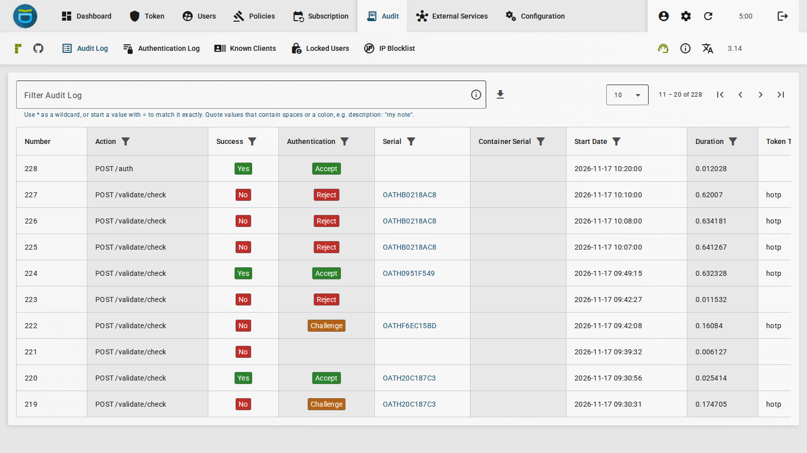

.. index:: Audit
.. _audit:

Audit
=====

The system provides a sophisticated audit log, which can be viewed in the
WebUI.

   *Audit Log*

privacyIDEA comes with a default SQL audit module (see :ref:`code_audit`).

Next to the audit log, privacyIDEA keeps an :ref:`authentication_log` which
records the outcome of every authentication request.

privacyIDEA also provides a :ref:`logger_audit` and
a :ref:`container_audit` which can be used to send privacyIDEA audit log messages
to services like Splunk or Logstash.

.. _sql_audit:

SQL Audit
---------

.. _audit_search:

Searching the audit log
~~~~~~~~~~~~~~~~~~~~~~~

The audit log can be filtered in the WebUI and via the ``GET /audit/`` API by
the columns of the audit entries (``number``, ``user``, ``realm``, ``serial``,
``action``, ``log_level``, ...). The entry ``number`` is compared exactly.
``sig_check`` and ``missing_line`` are computed when the entries are read and
can not be filtered. A filter with a key that is not an audit column is
ignored, so it does not restrict the result. The ``GET /audit/`` API matches
filter values as follows:

* ``*`` is the wildcard and matches any sequence of characters. For example,
  ``action=*/token/init`` matches every action ending in ``/token/init`` and
  ``serial=OATH*`` matches every serial starting with ``OATH``.
* All other characters are matched literally. In particular ``%`` and ``_`` are
  *not* wildcards. A value that contains no ``*`` must match the column exactly.
* A leading ``!`` negates the condition, e.g. ``authentication=!CHALLENGE``
  returns the entries whose ``authentication`` is not ``CHALLENGE``. This does
  not apply to ``success``: filter it with ``1`` (successful) or ``0``
  (failed); a value with ``!``, e.g. ``!0``, selects the failed entries.

The WebUI searches anywhere in the column: it wraps every filter value in ``*``
before it sends it, so ``user: corn`` finds *cornelius*. Prefix a value with
``=`` to match the whole column, e.g. ``serial: =OATH0001``. A negation has to
be written this way too, e.g. ``authentication: =!CHALLENGE``; without the
``=`` the WebUI searches for the text ``!CHALLENGE``. In the previous WebUI
every value is searched anywhere in the column, and a negation is not possible.

The ``GET /audit/`` API and the CSV download also accept an ISO 8601 time
interval in the filters ``startdate`` and ``date``. The interval has the form
``start/end``. Each bound is an ISO 8601 timestamp, e.g.
``startdate=2026-11-05T00:00:00Z/2026-11-05T23:59:59Z``. The readable form with
a space before the offset, e.g. ``2026-11-05 14:30:00 +01:00``, is accepted too.

Both bounds are inclusive. If the end is given in whole seconds, the whole
second is included. If the end is only a date, it means 00:00:00 of that day.
If a bound has no offset, it is taken as UTC.

Leave out a bound for an open end, e.g. ``start/`` or ``/end``. A ``/`` alone
is no filter. A value without ``/`` is a text filter as before. The API returns
HTTP 400 if an interval contains ``!`` or ``*``, if it has more than one ``/``,
if a bound is invalid or if the start lies after the end.

An interval on ``startdate`` selects requests by their start. An interval on
``date`` selects requests by their end.

In the current WebUI the filter button in the header of the *Start Date* column
opens a calendar. If you choose a first and a last day, the range runs from the
start of the first day to the end of the last day. If you choose one day, the
range is that day. The days are in the local time of the browser. Check *Time*
in the calendar to choose a start time and an end time for these days. If only
one day is chosen, the range ends at 23:59:59 of that day. If you reopen the
calendar with *Time* checked, it shows the active range with its times, and the
first day you click starts a new range. If you close the calendar without
choosing a time for that day, the range is the whole day. *Clear Filter* in the
calendar removes the range. The filter button of a date cell selects the local
day of that entry.

The filter text shows the range as one ``startdate`` value with the offset of
the browser, e.g.
``startdate: "2026-11-05 00:00:00 +01:00/2026-11-05 23:59:59 +01:00"``. If
you type a bound without an offset in a ``startdate`` or ``date`` interval,
the WebUI reads it as the local time of the browser. A typed end that is only
a date includes that whole day.

The WebUI applies a typed interval in ``startdate`` or ``date`` when you press
Enter. The calendar and the filter button of a date cell apply at once. The
WebUI sends a bound it cannot read as you typed it, and the API refuses an
invalid bound with an error. ISO 8601 forms that only the API reads, e.g.
``2026-11-05T10``, ``20261105`` or ``2026-W45``, are taken as UTC, not as the
local time of the browser.

Entries written by privacyIDEA 3.15 or later store ``date`` and ``startdate``
in UTC. The API returns them with the offset ``+00:00``. The current WebUI
shows them in the local time of the browser. Older entries keep the local time
of the server that wrote them. The API returns them without an offset. The
column ``entry_version`` of the audit table tells the two kinds apart. It holds
``2`` for an entry in UTC and is empty (``NULL``) for an older entry in the
local time of the server.

A time interval compares older entries in the local time of the server. A text
filter on ``date`` or ``startdate`` compares the stored value. It matches older
entries in server time and new entries in UTC.

.. versionchanged:: 3.14 ``*`` is the only wildcard. Earlier versions also
   treated a literal ``%`` as a wildcard in the audit search; now ``%`` and
   ``_`` match literally. Update any saved filters or integrations that relied
   on ``%`` to use ``*`` instead.

.. versionchanged:: 3.15 New audit entries are stored in UTC. The filters
   ``date`` and ``startdate`` of the API and the CSV download accept an ISO 8601
   time interval. Text filters on ``date`` or ``startdate`` match new entries in
   UTC.

.. index:: Audit Log Rotate
.. _audit_rotate:

Cleaning up entries
~~~~~~~~~~~~~~~~~~~

The ``sqlaudit`` module writes audit entries to an SQL database.
For performance reasons the audit module does not remove old audit entries
during the logging process.

But you can set up a cron job to clean up old audit entries. Audit entries
can be cleaned up either based on the number of entries or
based on the age. A config file (``--config``) takes precedence over the age,
and the age takes precedence over the number of entries.

The Ubuntu packages ship such a job commented out; the Docker image rotates by
the number of entries, see :ref:`cleanup_jobs`.

The ``--chunksize`` parameter allows cleaning up audit
entries in chunks to avoid excessive memory usage.

Cleaning based on the number of entries:
^^^^^^^^^^^^^^^^^^^^^^^^^^^^^^^^^^^^^^^^

You can specify a *highwatermark* and a *lowwatermark*. To clean
up the audit log table, you can call :ref:`the pi-manage script <pimanage>` on
the command line::

   pi-manage audit rotate --highwatermark 20000 --lowwatermark 18000

If there are more than 20000 log entries, this will clean up all old log entries, leaving only 18000 log entries.

If neither ``--config`` nor ``--age`` is given, the command cleans by the number of entries, with the defaults
``--highwatermark 10000`` and ``--lowwatermark 5000``: ``pi-manage audit rotate`` without options deletes all but the
newest 5000 entries as soon as there are more than 10000.

Cleaning based on the age:
^^^^^^^^^^^^^^^^^^^^^^^^^^

You can specify the maximum age of an audit entry in days::

   pi-manage audit rotate --age 365

This will delete all audit entries that are older than one year.

.. index:: retention time

Cleaning based on the config file:
^^^^^^^^^^^^^^^^^^^^^^^^^^^^^^^^^^

Using a config file, you can define different retention times for the audit data.
E.g. this way you can define that audit entries about token listings can be deleted after
one month,
while the audit information about token creation will only be deleted after ten years.

The config file is in a *YAML* format and looks like this::

    # DELETE auth requests of nils after 10 days
    - rotate: 10
      user: ^nils$
      action: .*/validate/check.*

    # DELETE auth requests of friedrich after 7 days
    - rotate: 7
      user: ^friedrich$
      action: .*/validate/check.*

    # Delete nagios user test auth directly
    - rotate: 0
      user: ^nagiosuser$
      action: POST /validate/check.*

    # Delete token listing after one month
    - rotate: 30
      action: ^GET /token/

    # Delete audit logs for token creation after 10 years
    - rotate: 3650
      action: ^POST /token/init$

    # Delete everything else after 6 months
    - rotate: 180
      action: .*

This is a list of rules.
privacyIDEA iterates over *all* audit entries. The first matching rule for an entry wins.
If the rule matches, the audit entry is deleted if the entry is older than the days
specified in "rotate".

It is a good idea to have a *catch-all* rule at the end. A rule needs at least one condition besides
"rotate", a rule without one matches no entry. The catch-all rule above uses ``action: .*``.

.. note:: The keys "user", "action"... correspond to the column names of the audit table.
   You can use any column name here like "date", "action", "action_detail", "success", "serial", "administrator",
   "user", "realm"... for a complete list, see the model definition here: :class:`privacyidea.models.Audit`.
   The values are Python regular expressions that are searched anywhere in the column value: ``user: nils``
   would also match *nilsson* and *anils*. Use ``^`` and ``$`` to match the whole value, as in the example above.

You can then add a call like::

   pi-manage audit rotate --config /etc/privacyidea/audit.yaml

in your crontab.

With a config file, the matching entries are deleted in slices of ``--chunksize`` entries, or
of 1000 entries without it. The command reads all audit entries to match them against the
rules, so if the audit table is very big, consider cleaning based on the age or number of
entries first.

Access rights
~~~~~~~~~~~~~

You may also want to run the cron job with reduced rights, e.g. as a user who
has no read access to the original pi.cfg file, since this job does not need
read access to the ``SECRET_KEY`` or ``PI_PEPPER`` in the pi.cfg file.

So you can simply specify a config file with only the content::

   PI_AUDIT_SQL_URI = <your database uri>

Then you can call ``pi-manage`` in the cron job like this::

   PRIVACYIDEA_CONFIGFILE=/etc/privacyidea/audit.cfg \
   pi-manage audit rotate --config /etc/privacyidea/audit.yaml

This will read the configuration (only the database URI) from the config file
``audit.cfg`` and the rotation rules from ``audit.yaml``, so the user of the
cron job needs read access to both. ``--age`` or the watermarks can be used the
same way. Always give one of these options: without any of them, the command
keeps only the newest 5000 entries (see above).

.. _audit_table_size:

Table size
~~~~~~~~~~

The entries to be written to the database may be longer than the column in the
database, since they contain data from the request. Such an entry is shortened
to the length of the column, so that it is still written: a database rejects a
value that is too long, which would lose the whole entry. Values that hold a
list of items, like the serials of all tokens of a request, are shortened per
item, so that every item stays recognizable.

The length of a column is read from the database, so a table whose columns are
narrower than the ones privacyIDEA ships is handled without any configuration:
its entries are shortened to what it really accepts instead of being rejected.

Reading the database can only shorten a value further, though, never lengthen
it: a wider column is not used on its own. So if you increase a column length
by the usual database means
(e.g. :code:`ALTER TABLE pidea_audit MODIFY user varchar(1000);` for MariaDB),
tell privacyIDEA about it in your :ref:`config file <cfgfile>`::

    PI_AUDIT_SQL_COLUMN_LENGTH = {"user": 1000,
                                  "policies": 1000}

which allows entries to use the additional space. Without this setting, values
are still shortened to the length privacyIDEA ships and the space you added
stays unused. Check the database schema for the available columns here:
:class:`privacyidea.models.Audit`.

.. note:: The setting ``PI_AUDIT_SQL_TRUNCATE`` is not needed any more and is
   ignored. Entries are always shortened to what the audit table can hold.

.. _logger_audit:

Logger Audit
------------

The *Logger Audit* module can be used to write audit log information to
the Python logging facility and thus write log messages to a plain file,
a syslog daemon, an email address or any destination that is supported
by the Python logging mechanism. The log message passed to the Python logging
facility is a JSON-encoded string of the fields of the audit entry.

You can find more information about this in :ref:`advanced_logging`.

To activate the *Logger Audit* module you need to configure the following
settings in your :ref:`pi.cfg <cfgfile>` file::

   PI_AUDIT_MODULE = "privacyidea.lib.auditmodules.loggeraudit"
   PI_AUDIT_SERVERNAME = "your choice"
   PI_LOGCONFIG = "/etc/privacyidea/logging.cfg"

You can optionally set a custom logging name for the logger audit with::

   PI_AUDIT_LOGGER_QUALNAME = "pi-audit"

It defaults to the module name ``privacyidea.lib.auditmodules.loggeraudit``.
Use the same name as ``qualname`` of the audit logger in the logging
configuration below. In contrast to the :ref:`sql_audit` you *need* a logging
configuration file that defines the audit logger (``PI_LOGCONFIG``, default
``/etc/privacyidea/logging.cfg``), otherwise the *Logger Audit* will not work
correctly.

In the ``logging.cfg`` you then need to define the audit logger::

   [logger_audit]
   handlers=audit
   qualname=privacyidea.lib.auditmodules.loggeraudit
   level=INFO
   propagate=0

   [handler_audit]
   class=logging.handlers.RotatingFileHandler
   backupCount=14
   maxBytes=10000000
   formatter=detail
   level=INFO
   args=('/var/log/privacyidea/audit.log',)

Note that the ``level`` always needs to be *INFO*. In this example, the
audit log will be written to the file ``/var/log/privacyidea/audit.log``.

``propagate=0`` keeps the audit entries out of the other log files. Without
it, every entry is also passed to the handlers of the parent loggers (with the
default name, those of the ``privacyidea`` logger) and ends up in the
privacyIDEA log file as well.

Finally you need to extend the following settings with the defined audit logger
and audit handler::

   [handlers]
   keys=file,audit

   [loggers]
   keys=root,privacyidea,audit

.. note:: The *Logger Audit* can only **write** audit information. It
   cannot be used to **read** data. So if you are only using the
   *Logger Audit*, you will not be able to *view* audit information in the
   privacyIDEA WebUI!
   To still be able to *read* audit information, take a look at the
   :ref:`container_audit`.

.. note:: The policies :ref:`policy_auth_max_success`
   and :ref:`policy_auth_max_fail`
   depend on reading the audit log. If you use a non-readable audit log
   like the *Logger Audit* these policies will not work.

.. _container_audit:

Container Audit
---------------

The *Container Audit* module is a meta audit module that can be used to
write audit information to more than one audit module.

It is configured in the ``pi.cfg`` like this::

    PI_AUDIT_MODULE = 'privacyidea.lib.auditmodules.containeraudit'
    PI_AUDIT_CONTAINER_WRITE = ['privacyidea.lib.auditmodules.sqlaudit','privacyidea.lib.auditmodules.loggeraudit']
    PI_AUDIT_CONTAINER_READ = 'privacyidea.lib.auditmodules.sqlaudit'

The key ``PI_AUDIT_CONTAINER_WRITE`` contains a list of audit modules,
to which the audit information should be written. The listed
audit modules need to be configured as mentioned in the corresponding audit
module description.

The key ``PI_AUDIT_CONTAINER_READ`` contains one single audit module that
is capable of reading information. In this case the :ref:`sql_audit` module can be
used. The :ref:`logger_audit` module can **not** be used for reading!

Using the *Container Audit* module you can on the one hand send audit information
to external services using the :ref:`logger_audit` but also keep the
audit information visible within privacyIDEA using the :ref:`sql_audit` module.
