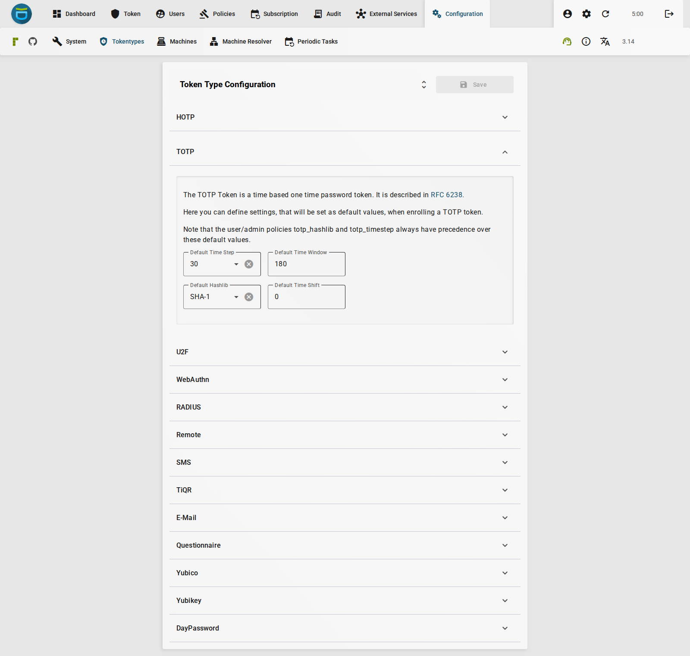

.. _token_config:

Token configuration
--------------------

.. index:: token configuration

Each of the :ref:`tokentypes` can provide its own configuration. Under *Configuration -> Tokentypes*, each token type
has its own section, in which you can define default values for this token type. Some tokens additionally require :ref:`configuration` such as the configuration
of an SMTP server.

   *The token type configuration with the TOTP section opened*

.. toctree::
   :glob:
   :maxdepth: 1

   tokenconfig/*