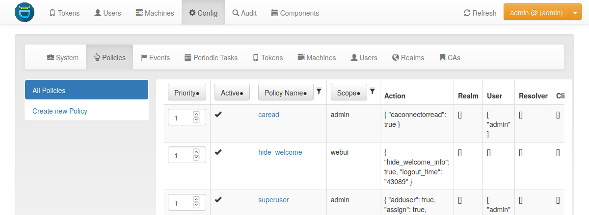

.. _policies:

Policies
========

.. index:: policies, scope

Policies can be used to define the reaction and behavior of the system.

Each policy defines the behavior in a certain area, called scope.
privacyIDEA knows these scopes:

.. toctree::
   :maxdepth: 1

   admin
   user
   authentication
   authorization
   enrollment
   webui
   register
   container
   token
   hardening
   conditional_access

You can define as many policies as you wish to.
The logic of the policies in the scopes is additive.

   *Policy Definition*

You can use policy templates to ease the setup.

.. toctree::
   :maxdepth: 1

   templates

Each policy can contain the following attributes:

**policy name**

  A unique name of the policy. The name is the identifier of
  the policy. If you save a policy under an existing name, the
  existing policy is updated: the attributes sent in the request
  replace the stored ones, all others keep their values. The
  WebUI always sends the whole policy.

  .. note:: In the web UI and the API policies can only be created
     with the characters 0-9, a-z, A-Z, ``_``, ``-`` and ``.``.
     The names ``check`` and names starting with ``pi-update-policy-``
     are reserved.
     On a library level or during migration scripts policies with
     other characters could be created.

.. versionadded:: 2.0

**scope**

  The scope of the policy as described above.

.. versionadded:: 2.0

**priority**

  The priority field of policies contains a positive number and defaults to 1.
  In case of policy conflicts, policies with a lower priority number take precedence.

  It can be used to resolve policy conflicts. An example is the :ref:`passthru_policy` policy:
  Assume there are two passthru policies ``pol1`` and ``pol2`` that
  define different action values, e.g. ``pol1`` defines ``passthru=userstore``
  and ``pol2`` defines ``passthru=radius1``.
  If multiple policies match for an incoming authentication request, the priority
  value is used to determine the policy that should take precedence: Assuming ``pol1``
  has a priority of 3 and ``pol2`` has a priority of 2, privacyIDEA
  will honor only the ``pol2`` policy and authenticate the user against the RADIUS server ``radius1``.

  Policy conflicts can still occur if multiple policies with the same priority
  specify different values for the same action.

.. versionadded:: 2.23

**description**
    Use this to describe your policy in more detail.

.. versionadded:: 3.10

**action**

  This is the important part of the policy.
  Each scope provides its own
  set of actions.
  An action describes that something is *allowed* or
  that some behavior is configured.
  A policy can contain several actions.
  Actions can be of type ``bool``, ``string`` or ``integer``.
  Boolean actions are enabled by just adding this action - like
  ``scope=user:action=disable``, which allows the user to disable their own
  tokens.
  ``string`` and ``integer`` actions require an additional value - like
  ``scope=authentication:action='otppin=userstore'``.

  An action with a leading ``-`` or ``!`` is excluded from the policy, also
  from a ``*`` that stands for all actions: the admin policy
  ``*, -policywrite`` allows every admin action but writing policies. Another
  policy can still allow the excluded action.

  A boolean action saved with the value ``false`` (in any case) or ``0``, like
  ``policywrite=false``, is disabled: it is stored as the excluded action
  ``-policywrite``. This also applies to importing a policy.

.. versionadded:: 2.0

Conditions
----------

The conditions of a policy decide for which requests the policy applies. A policy
applies to a request only if the request matches all conditions of the policy. A field
that you leave blank matches every request.

The fields *realm*, *resolver* and *user*, and *admin realm* and *admin user*, each take a
list of values. ``*`` stands for every value, and a value with a leading ``!`` or ``-`` is
excluded, also from ``*``: the realm ``*, !sales`` means every realm but *sales*. A field
of nothing but exclusions matches no value at all.

In *user* and *admin user* every value other than ``*`` is a regular expression that has to
match the whole name: ``corn.*`` matches *cornelius*, while ``corn*`` means ``cor`` followed
by any number of ``n``. A dot matches any character, so ``john.doe`` also matches
*johnXdoe*. Each value must be a valid regular expression. A comma separates two values,
so an expression can not contain a comma. Realm and resolver values must name existing
realms and resolvers.

privacyIDEA can only check a condition if the request has the data for it. For example,
the WebUI start page has no user. :ref:`policy_condition_checks` shows which data each
kind of request has, and which actions have special rules.

.. toctree::
   :maxdepth: 1

   condition_checks

**realm**

  This is the realm, for which this policy is valid.

  If this field is left blank, this policy is valid for all realms.

.. versionadded:: 2.0

**resolver**

  This policy is valid for the users of the resolvers in this field.

  If this field is left blank, this policy is valid for all resolvers.

  A user belongs to one resolver only. If the same login name exists in
  several resolvers of a realm, the user belongs to the resolver with the
  highest priority (see :ref:`resolver_priority`). By default, a policy for
  another resolver of the realm does not apply to this user, even if that
  resolver also contains the login name.

.. _check_all_resolvers:

**Check all possible resolvers of a user**

  With this option, the policy also applies to users who are contained in one
  of its resolvers, but belong to another resolver of their realm. A resolver
  with a lower priority can then work like a group, for example a list of the
  login names that can use a VPN. Only the resolvers with a lower priority than
  the user's resolver count.

  Example: the realm *company* contains the resolvers *ldap* (priority 1) and
  *vpn-users* (priority 2). *vpn-users* lists some of the login names of
  *ldap*. A policy for the resolver *vpn-users* applies to

  * without the option: only the users that exist in *vpn-users* but not in
    *ldap*,
  * with the option: in addition, the users of *ldap* that are also listed in
    *vpn-users*. Users of *ldap* that are not listed in *vpn-users* are not
    affected.

  The option needs the login name and the realm of the user. If the request has an
  empty user, for example an administrator acts on a token without an owner, a policy
  with the option does not apply. If the request has no user at all, like the WebUI
  start page, privacyIDEA does not check the resolver, and the policy applies. See
  :ref:`policy_condition_checks`.

  The option only works together with a resolver. In the WebUI it is the
  checkbox below the resolvers of the policy. It can only be selected while a
  resolver is selected, and a policy with the option but without a resolver
  can not be saved. The policy list shows *all resolvers of the user* next to
  the resolvers of such a policy.

.. versionadded:: 2.0

.. versionadded:: 2.17 ``check_all_resolvers``

**user**

  This is the user, for whom this policy is valid: the user who authenticates or acts on their own tokens, and in
  the scope *admin* the user an administrator acts on. It never names the administrator, who is matched by the
  *admin realm* and *admin user* below.

  If this field is left blank, this policy is valid for all users.

  privacyIDEA compares the login name that the resolver returns for the user. A resolver
  can have several login name attributes, for example the user name and the email address.
  A user can then log in with each of them, but the policy must contain the first login
  name.

  .. note:: Starting with version 3.10 you can choose if the username and the
    adminname have to match case-sensitively or not.

.. versionadded:: 2.0

**admin realm** and **admin user**

  Only in the scope *admin*: the realm and the login name of the administrator for whom this policy is valid,
  ``adminrealm`` and ``adminuser`` in the API. See :ref:`admin_policies`.

  If these fields are left blank, this policy is valid for all administrators.

  privacyIDEA has two kinds of administrators, see :ref:`faq_admins`:

  * An administrator of an admin realm is a user of a realm in ``SUPERUSER_REALM``. Their
    admin realm is this realm.
  * A local administrator, which you create with ``pi-manage admin add``, has no admin
    realm. A policy with an admin realm does not apply to local administrators. A policy
    without an admin realm, or with the admin realm ``*``, applies to them.

  The admin user is the login name for both kinds.

.. versionadded:: 2.4 *admin realm*

.. versionadded:: 3.3 *admin user*

**privacyIDEA Node**

  If you have a redundant setup requests can hit different dedicated nodes of
  your privacyIDEA cluster. If you want a policy to only be valid for certain
  privacyIDEA Nodes, you can set a list of allowed nodes.

  This can be useful if you e.g. only want certain administrative actions on
  dedicated nodes.

  Enter the names of the nodes. The field does not support ``*`` or exclusions.
  The nodes are configured in pi.cfg. See :ref:`cfgfile`.

.. versionadded:: 3.4

**time**

  In the time field of a policy you can define a list of time ranges. A time
  range can consist of days of the week (*dow*) and of times in 24h format.
  Possible values are::

     <dow>: <hh>-<hh>
     <dow>: <hh:mm>-<hh:mm>
     <dow>-<dow>: <hh:mm>-<hh:mm>

  You can combine these forms in a list separated by commas, like::

     Mon-Fri: 8-18, Sat: 10-12

  to define certain policies to be active throughout working hours.

  The days are ``Mon``, ``Tue``, ``Wed``, ``Thu``, ``Fri``, ``Sat`` and ``Sun``. A day
  range goes from the first day to the second day in this order. For a range over the
  end of the week, use two ranges, like ``Sat-Sun: 8-18, Mon: 8-18``.

  Times are the local time of the privacyIDEA server, compared at minute precision with
  both ends included: ``8-18`` means from 08:00 up to and including 18:00, and ``0-23``
  ends at 23:00. For a whole day, use ``0:00-23:59``. A range can not cross midnight
  (``22-6`` is rejected).

  .. note:: If the time of a policy does not match, the policy is not found.
     This can lead to unintended side effects. Carefully consider this before
     using time restricted policies.

.. versionadded:: 2.12

.. _client_policies:

**client**

  This is the requesting client for which this action is valid.
  You can use this to define policies in which the user is allowed to manage
  their tokens depending on their IP addresses (like the internal network or
  remotely via the firewall).

  You can enter several IP addresses or subnets, IPv4 and IPv6, divided by comma.
  Exclude an item with a leading exclamation mark (like
  ``10.2.0.0/16, !10.2.0.1, 192.168.0.1``). Host names are not supported.

  A field with only exclusions matches no client. To match every client except one, add
  the networks of all clients, like ``0.0.0.0/0, ::/0, !10.2.0.1``.

  A web server that accepts IPv4 and IPv6 on one socket reports an IPv4 client as
  ``::ffff:a.b.c.d``. privacyIDEA uses the IPv4 address ``a.b.c.d`` as the client IP, so
  the IPv4 entries apply. An IPv4 network does not match a client with a native IPv6
  address, and ``::/0`` does not match an IPv4 client.

  The client is the IP address from which privacyIDEA receives the request. Behind a
  reverse proxy, this is the proxy. For an authentication through a RADIUS server or
  another plugin, this is the server of the plugin, not the device of the user. To use
  the address of the original client, configure :ref:`override_client`.

.. versionadded:: 2.0

**User Agent**

  This is the user agent of the requesting client for which this action is valid. You can use this to define policies
  depending on the plugin. Multiple plugins can be selected from the drop-down list. But you can also add custom
  user agents. The matching is applied to the name, but not to the version. It is case-insensitive.

  The name is the first part of the ``User-Agent`` header of the request. It contains only
  letters, digits, ``_`` and ``-``. It ends at the first other character, like ``/``, a
  space or a dot. Thus ``PAM.module/1.0`` has the name ``PAM``. The privacyIDEA
  plugins send their own name, for example ``privacyIDEA-Keycloak``. Browsers send
  ``Mozilla``. For an authentication through a plugin, the user agent is the plugin, not
  the browser of the user. The field does not support ``*`` or exclusions. A request
  without a user agent only matches policies without a user agent. A header that starts
  with another character counts as no user agent.

.. versionadded:: 3.12

**additional conditions**

  Using conditions you can specify more advanced rules that determine whether
  a policy is valid for a request.

  Conditions are described on the following page:

.. toctree::
    :maxdepth: 1

    conditions

.. versionadded:: 3.1
