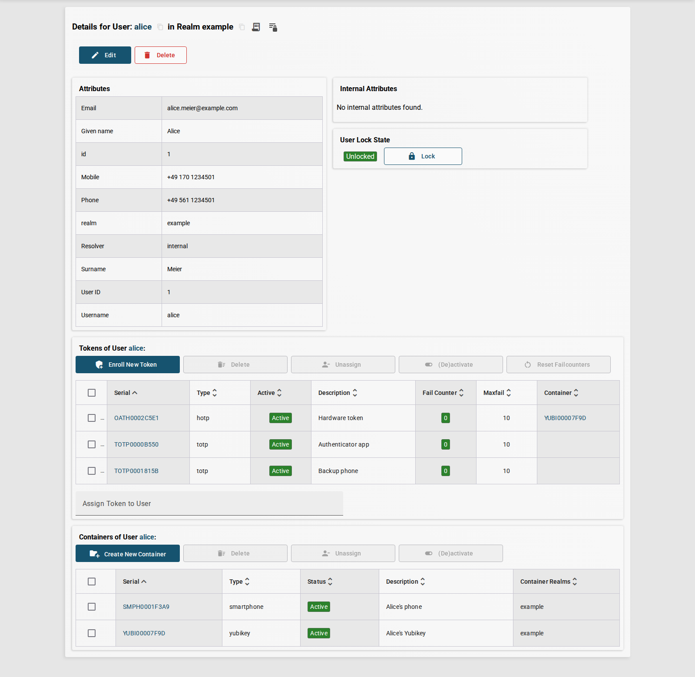

.. _user_details:

User Details
------------

When clicking on a username, you can see the user's details and perform
several actions on the user.

   *User Details.*

You see a list of the user's tokens and change to the :ref:`token_details`.
On the bottom, a list of the user's containers is displayed. You can click on the serial to change to the container
details (:ref:`container_view`).

Enable and Disable Tokens
.........................

A token can be enabled or disabled by clicking on the *Active* or *Deactivated* label. To change several tokens at
once, select them and click *(De)activate*.

Reset Failcounter
.................

To reset the failcounter of a token, click on the number in the failcounter column. To reset several tokens at once,
select them and click *Reset Failcounters*.

Unassign Tokens
...............

To unassign the user from tokens, select the tokens and click *Unassign*.

Delete Tokens
.............

Tokens can be deleted by selecting them and clicking *Delete*. You will be asked if you are
sure you want to delete the tokens. Confirm and the tokens will be deleted.

Enroll tokens
.............

In the user's details view you can enroll additional tokens to the user. Click *Enroll New Token*. On
the enrollment page the user is already selected and you only need to choose
what tokentype you wish to enroll for this user.

Add tokens to container
.......................

You can also add tokens to a container from the user's details view. Select the checkboxes for the tokens you want to
add and click *Add to Container*. The button is only shown if you have the right ``container_add_token`` and is
disabled as long as no token is selected.

A dialog opens in which you enter the serial of an existing container. While you type, matching containers are
suggested. The containers of the user are shown as buttons above the field, a click on a button fills in its serial.
A new container cannot be created in this dialog. Create it first as described in :ref:`container_functionality`.

If the chosen container does not belong to the user yet and you have the right ``container_assign_user``, the checkbox
*Assign Container to this user* is shown. If the container belongs to another user, the dialog names this user.
When the checkbox is set, the container is moved to the user and the previous owner is replaced.

.. note:: The previous WebUI, see :ref:`legacy_webui`, offers to create a new container in the same step.

Assign tokens
.............

You can assign a new, already existing token to the user. Just start typing
the token serial number in the field *Assign Token to User*. The system will search for tokens, that are not
assigned yet and present you a list to choose from.

View Audit and Authentication Log
.................................

The audit log and the authentication log of the user are opened with the icon
buttons next to the user name and realm at the top of the page.

The icon button *Show audit log of user* (a receipt) takes you to the
:ref:`audit` log filtered on the login name and the realm of this user. The
audit log searches anywhere in a column by default, so both values are asked
for in full with the ``=`` prefix: ``user: =ann realm: =<realm>``. The log
therefore lists only the entries of this user in this realm, and not those of
``ann`` in another realm or of ``joanna``. Remove a ``=`` to widen the filter
to a partial match again.

The icon button *Show authentication log of user* (a list with a lock) takes
you to the :ref:`authentication_log` filtered on the login name and the realm
of this user as well. The authentication log matches every filter exactly, so
no ``=`` prefix is needed there. The button is only shown to administrators
with the admin policy action ``authentication_log_read``.

Edit user
.........

.. index:: Edit Users, Editable Resolver

If the user is located in a resolver that is marked as editable, the
administrator will also see a button *Edit*. The button requires the admin
policy actions ``updateuser`` and ``resolverread``. To read more about this,
see :ref:`manage_users`.
